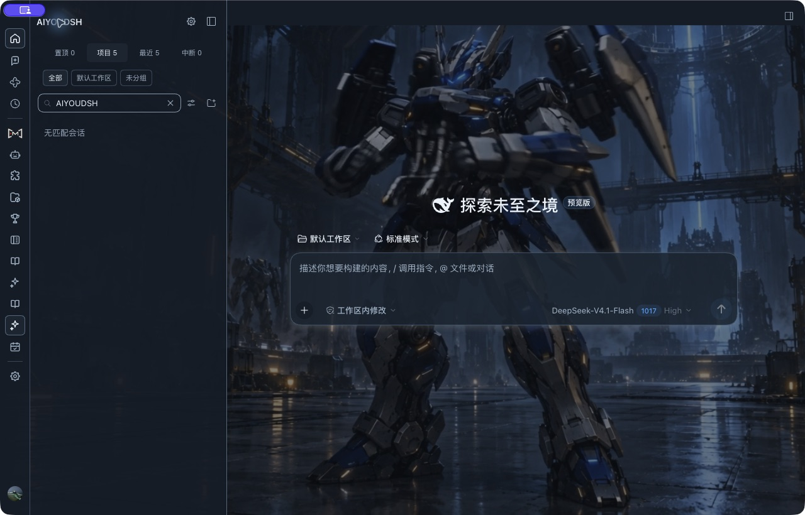
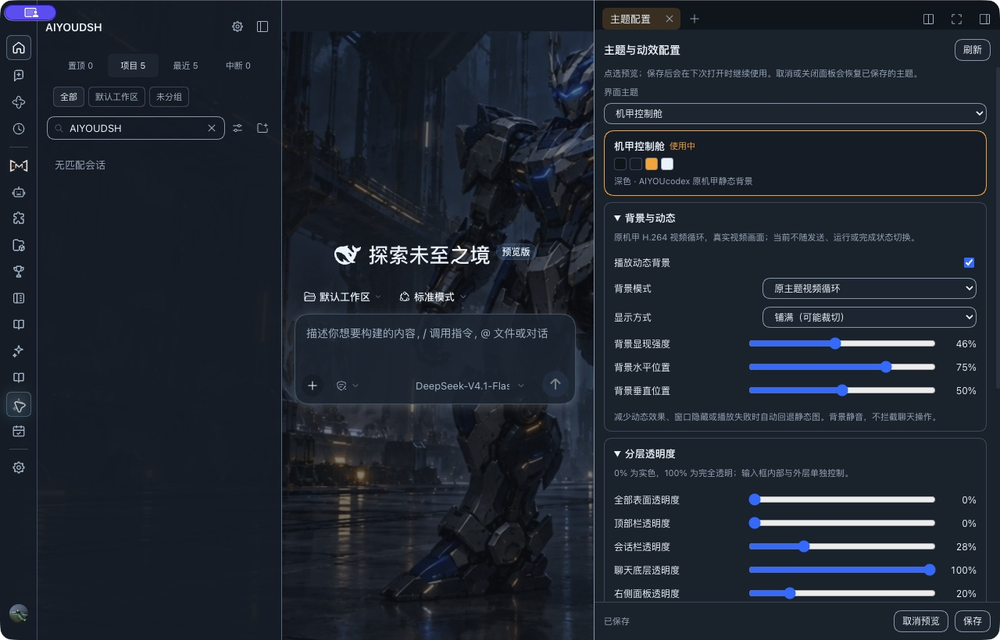
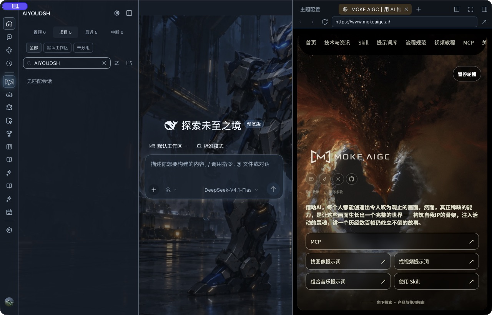
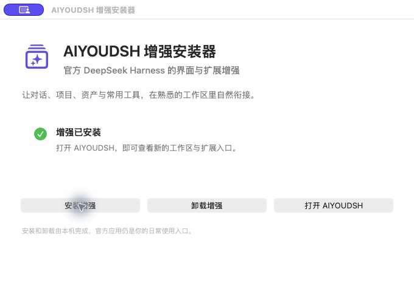
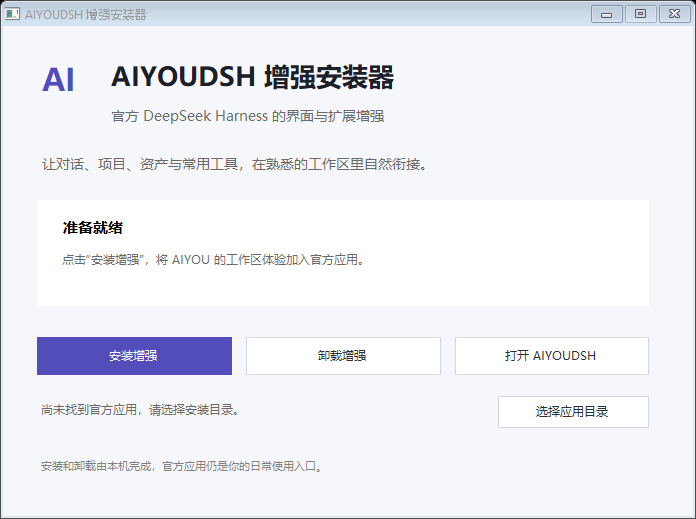
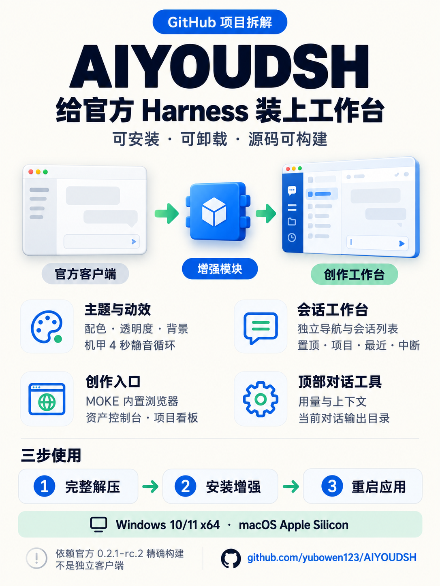

# AIYOUDSH

[](https://github.com/yubowen123/AIYOUDSH/actions/workflows/verify.yml)
[](https://github.com/yubowen123/AIYOUDSH/releases/latest)
[](LICENSE)

**让官方 DeepSeek Harness 拥有更完整的工作台、主题和创作入口。**

AIYOUDSH 是可安装、可卸载的桌面增强包：基于官方安装包的原生扩展接口，重新整理导航和对话侧栏，加入主题配置、动态背景、本地资产与项目管理。v0.7.1 本地融合版把 AIYOUPLUS 画布与创作工具纳入同一插件，文字使用宿主模型，素材使用 DSH 统一素材库。本轮新增能力在 macOS Apple Silicon 上验证；v0.5.0 的 Windows x64 支持保留，新增画布能力的 Windows 桌面验收尚未完成。

[下载 v0.5.0](https://github.com/yubowen123/AIYOUDSH/releases/tag/v0.5.0) · [安装与卸载](docs/installation.md) · [功能说明](docs/features.md) · [主题与动效](docs/themes.md) · [构建源码](docs/development.md) · [问题反馈](https://github.com/yubowen123/AIYOUDSH/issues)



当前 v0.7.1 是本地融合交付包，未发布到 GitHub。使用随包的安装器；下方保留 v0.5.0 的历史公开下载链接。

## 下载与兼容

| 平台 | 安装包 | 条件 |
| --- | --- | --- |
| Windows 10 / 11 x64 | [AIYOUDSH-v0.5.0-windows-x64.zip](https://github.com/yubowen123/AIYOUDSH/releases/download/v0.5.0/AIYOUDSH-v0.5.0-windows-x64.zip) | 官方 x64 应用、.NET Framework 4.8；当前用户安装，无需管理员权限 |
| macOS Apple Silicon arm64 | [AIYOUDSH-v0.5.0-macos-arm64.zip](https://github.com/yubowen123/AIYOUDSH/releases/download/v0.5.0/AIYOUDSH-v0.5.0-macos-arm64.zip) | 官方 arm64 应用；原生 AppKit 安装器 |
| 可构建源码 | [AIYOUDSH-v0.5.0-source.zip](https://github.com/yubowen123/AIYOUDSH/releases/download/v0.5.0/AIYOUDSH-v0.5.0-source.zip) | Node.js 24 或更新版本；按平台构建 |

[SHA-256 校验文件](https://github.com/yubowen123/AIYOUDSH/releases/download/v0.5.0/AIYOUDSH-v0.5.0-SHA256SUMS.txt) · [v0.5.0 说明](docs/releases/v0.5.0.md) · [上一版 macOS v0.4.0](https://github.com/yubowen123/AIYOUDSH/releases/tag/v0.4.0)

两平台均精确适配官方 **`0.2.1-rc.2` / `332895e0f7c9d4dbfb29729f5eb367fa263ff986`**，各自校验对应平台的应用归档和组件哈希。不匹配时停止安装；Mac Intel 与 Windows ARM 不在当前支持范围。

## 工作台与功能

- **画布与创作。** 左侧画布、创作工具和媒体模型菜单；支持对话控制原画布、同库素材插入、图片/视频/音频自定义接口及文档智能配置。说明与验证边界见[融合说明](docs/integration/aiyouplus.md)。
- **统一工作台。** 独立竖向功能栏与会话列表，置顶、项目、最近、中断四类视图；搜索、摘要、标签和三色标注。工具在右侧打开，中间聊天保留。
- **完整主题配置。** 七套内置配色，背景位置与强度、14 项分层透明度、13 项颜色；支持实时预览、取消、保存和恢复系统默认。
- **真实动态背景。** 机甲使用原视频静音循环；关闭动态、系统减少动态或媒体失败时回退静态背景。
- **创作入口。** MOKE AIGC 使用官方内置浏览器；资产控制台和项目看板使用随包本地服务。
- **对话工具归位。** 用量与上下文、输出目录位于有消息对话的顶部右侧，绑定当前对话。

界面与窗口名称统一为 **AIYOUDSH**，Claude Code 功能模块、菜单及本增强拥有的遗留标签页已移除。官方应用包与系统应用入口保留原名。v0.7.1 运行库为 **18 个安装模块：2 个原生界面模块 + 16 个功能模块**。

Windows 版本使用独立官方基线和语义 CSS 映射适配原生界面与主题，并非将 Mac 包改名分发。功能范围、待连接的模型通道和验证边界见[功能说明](docs/features.md)。

## 界面预览

| 主题与动效配置 · macOS | MOKE 内置浏览器 · macOS |
| --- | --- |
|  |  |
| 各区域分别调节，修改先预览，保存后保留。 | 保留原生地址栏、前进后退、刷新和外部打开。 |



以上为 v0.4.0 的 macOS 实机截图，展示两平台共用的功能设计；不是 Windows 宿主界面截图。欢迎页在未发送演示消息的状态下拍摄，历史会话通过搜索筛选隐藏。[截图来源](docs/screenshots/README.md)



Windows 图为实际编译安装器在 GitHub Windows runner 中的准备界面，不是 Windows 宿主聊天截图。

## 项目知识卡片



基于本仓库功能与安装文档生成的项目图解；应用实机效果以上方截图为准。

## 安装

先正常打开一次受支持的官方 DeepSeek Harness，完成 profile 初始化，再**完整解压**对应平台增强包。

- **Windows：** 双击 `AIYOUDSHInstaller.exe`，点击“安装增强”。未自动找到官方应用时，选择包含 `DeepSeek Harness.exe` 和 `resources/app.asar` 的安装目录。不要仅移动安装器 EXE。
- **macOS：** 打开 `AIYOUDSH 增强安装器.app`，点击“安装增强”。

完成后退出并重新打开官方应用。卸载使用同一安装器的“卸载增强”；两平台也提供对应的安装/卸载脚本。

安装前自动建立备份。更新和卸载遇到用户后续修改时会保护现场并报告冲突；官方应用文件、已有会话、草稿与账号仍由宿主管理。[安装、路径与恢复规则](docs/installation.md)

## 源码构建

```sh
git clone https://github.com/yubowen123/AIYOUDSH.git
cd AIYOUDSH
npm run build
npm test
npm run verify
```

Node.js 24 起，默认按当前平台构建 `dist/addon/runtime/`；也可显式选择 `darwin-arm64` 或 `win32-x64` 目标。根构建使用随仓库依赖，无需先运行 `npm install`。macOS 打包使用 `npm run package`，Windows 使用 `npm run package:windows`。[开发与验证指南](docs/development.md)

## 当前范围

AIYOUDSH 是官方应用的外挂增强，不是可独立启动的官方 fork。源码包含可编辑 JavaScript 恢复分区、新增扩展与本地服务，不宣称还原官方原始 TypeScript 工程或与 AIYOUcodex 全功能等价。

机甲为 **4 秒背景视频循环**，其他主题使用静态背景或明确标注的中性纹理回退；原版事件动效、声音、轮播与媒体上传页尚未接入。MOKE 的登录和跨重启页面状态由官方 Browser 与站点管理。[主题清单](docs/themes.md) · [验证范围](docs/releases/v0.5.0.md#验证范围)

## 来源与许可

基于 [DeepSeek Harness](https://github.com/deepseek-ai/deepseek-harness) 发布组件及 AIYOUcodex 适配逻辑，保留 DeepSeek 与第三方项目的署名和许可。任务看板、资产服务、字体、YAML、MOKE 标识和主题媒体有各自来源；代码许可不转授第三方角色、商标或媒体权利。[许可与素材](docs/licensing.md) · [第三方声明](aiyou/THIRD_PARTY_NOTICES.md)

---

**English:** AIYOUDSH is a removable workbench and theme add-on for official DeepSeek Harness. v0.5.0 targets Windows 10/11 x64 and macOS Apple Silicon with platform-specific compatibility checks. It requires one exact `0.2.1-rc.2` build. Sources include editable JavaScript reconstruction partitions and extensions, not a standalone app or a restoration of the original TypeScript project. The gallery above shows macOS captures; see the release notes for validation scope.
